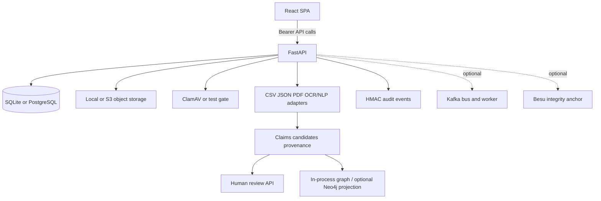

# DRISTI-NET Repository Map

Audit date: 2026-11-07. Read-only source inventory plus isolated build/test attempts. Runtime deployment not available for inspection.

## Inventory and stack

- Python 3.11 backend: FastAPI, SQLAlchemy/Alembic, Pydantic; API under `apps/api/app/`.
- TypeScript/React 18 SPA: Vite 8, React Router, Zustand, Sigma/Graphology; under `apps/web/src/`.
- DB adapters: SQLite local/default and SQLAlchemy support for PostgreSQL. Object storage: local filesystem and S3-compatible backend. Optional graph projection: Neo4j. Optional services/code paths include Redis rate limiting, Kafka worker transport, ClamAV, OCR/NLP adapters, and Besu anchoring.
- Synthetic corpus and evaluation data: `data/synthetic/`, `data/evaluation/`.
- Tests: API tests in `apps/api/app/tests/`; Playwright E2E in `tests/e2e/`; infrastructure and accessibility utilities under `tests/`.
- Deployment: `docker-compose.yml`, `Dockerfile`, `infrastructure/` (systemd/nginx), `Makefile`. No `.github/` CI workflow files were found. `.env` and `.env.compose` exist locally; values were not read or reproduced.
- Existing supporting artifacts: `audit/`, `frontend-audit/`, `reports/`, `operations/`, `security/`, `docs/`.

## Architecture and data flow

The code and docs describe PostgreSQL as authoritative, object storage as byte store, and Neo4j as rebuildable projection. Current live connections were not verified. `docs/status.md`, `docs/limitations.md`, and `audit/REPOSITORY_INVENTORY.md` disagree on Kafka adoption/state; see integration report.

## Relational model and constraints

`apps/api/app/models.py` defines `users`, `cases`, `case_assignments`, `evidence`, `jobs`, `entities`, `claims`, `provenance`, `match_candidates`, `reviews`, `audit_events`, `snapshots`, and `ledger_anchors` (registered by `services/integrity.py`). Notable constraints include unique username, unique case+evidence SHA-256, unique case+user assignment, and unique entity kind+canonical key. Claims and reviews are the evidence-linked analytical source; graph state is treated as rebuildable. Alembic migrations live in `apps/api/migrations/versions/`.

## Runtime services described by Compose

The current Compose file defines API, PostgreSQL, Neo4j, MinIO-compatible storage, ClamAV, one-shot migrations, worker, Redis, Kafka, Besu and an optional bundled Nginx profile. API/worker currently depend on multiple services being healthy; the implementation-level optionality differs from this deployment coupling. Compose runtime was not confirmed in this audit.

## Entry points

- API startup/routes: `apps/api/app/main.py`, `apps/api/app/routes/`.
- Auth/policy: `apps/api/app/auth.py`, `apps/api/app/routes/auth_routes.py`.
- Evidence pipeline: `apps/api/app/routes/evidence_routes.py`, `apps/api/app/services/{pipeline,extract,scanner,storage}.py`.
- Domain/data: `apps/api/app/models.py`, `schemas.py`, `db.py`, Alembic migrations.
- Graph/integrity: `services/{graph,graph_analytics,neo4j_store,integrity,audit}.py`.
- UI routes: `apps/web/src/app/router/router.tsx`; shared API client: `services/api/real_client.ts`; pages/features: `features/`; state: `stores/`.
- Worker: `workers/worker.py`.

## Inventory caveats

Repository includes generated `apps/web/dist/`, `node_modules/`, virtual environments, local env files, release archives, and `storage/`. No cleanup was performed. Git status was clean at the earlier inspection checkpoints represented by this report. This is an inventory, not a claim that every nested generated or ignored file was individually opened.

## 2026-11-10 recovery addendum

The current worktree was **not clean** at the recovery baseline: `.gitignore` was modified and twelve root `DRISTI_NET_*.md` files were untracked. They were preserved. `make build-web` regenerated ignored `apps/web/dist/`; no tracked source or screenshot changed. Fresh inventory, unread-file scope, and workspace state are recorded in `docs/audit/REPOSITORY_INVENTORY.md`, `docs/audit/UNREAD_FILES_REGISTER.md`, and `docs/audit/WORKSPACE_BASELINE_2026-11-10.md`. This addendum supersedes the cleanliness statement above for the 2026-11-10 baseline only.
