# DRISTI-NET — Multimodal Relationship Intelligence Platform

[](LICENSE)
[](https://python.org)
[](https://nodejs.org)
[](docker-compose.yml)
[](frontend-audit/P21_UI_AUDIT.md)
[](tests/)

**DRISTI-NET** (*Digital Record & Intelligence Synthesizer for Transparent Investigations — Network Evidence Tracker*) is an evidence-first, multimodal investigation and relationship-intelligence platform engineered for **authorized retrospective inquiry**.

The platform ingests complex digital investigation records (telecom call detail records, banking ledger exports, PDF FIRs, and seizure memos), cryptographically seals the chain of custody, enforces a fail-closed antivirus quarantine gate, extracts entities with coordinate-level source provenance, performs conservative human-in-the-loop entity disambiguation, and projects networks into an analytical POLE+ knowledge graph with temporal decay modeling and neutral legal dossier export.

> **Constitutional Guarantee ([docs/context.md](file:///home/ubuntu/DRISTI-NET/docs/context.md)):**  
> DRISTI-NET **does not decide who is a criminal** and never generates automated threat scores or labels suspects as "kingpins". Centrality is an analytical measure, not proof of guilt. A shared identifier indicates a *candidate relationship*, not proof of common identity. All entity merges require explicit, human-reviewed arbitration.

---

## Visual UI Showcase

| Interactive POLE+ Knowledge Graph | Human-in-the-Loop Review Arbitration |
| :---: | :---: |
| 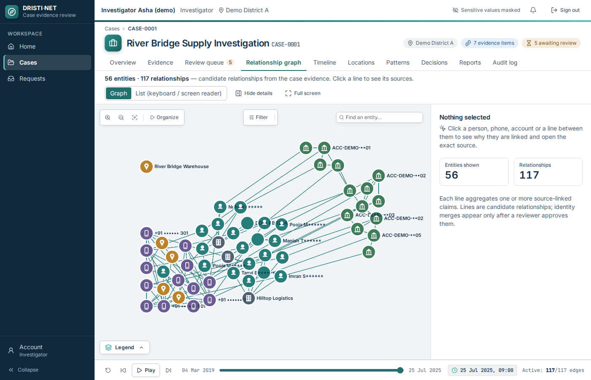 | 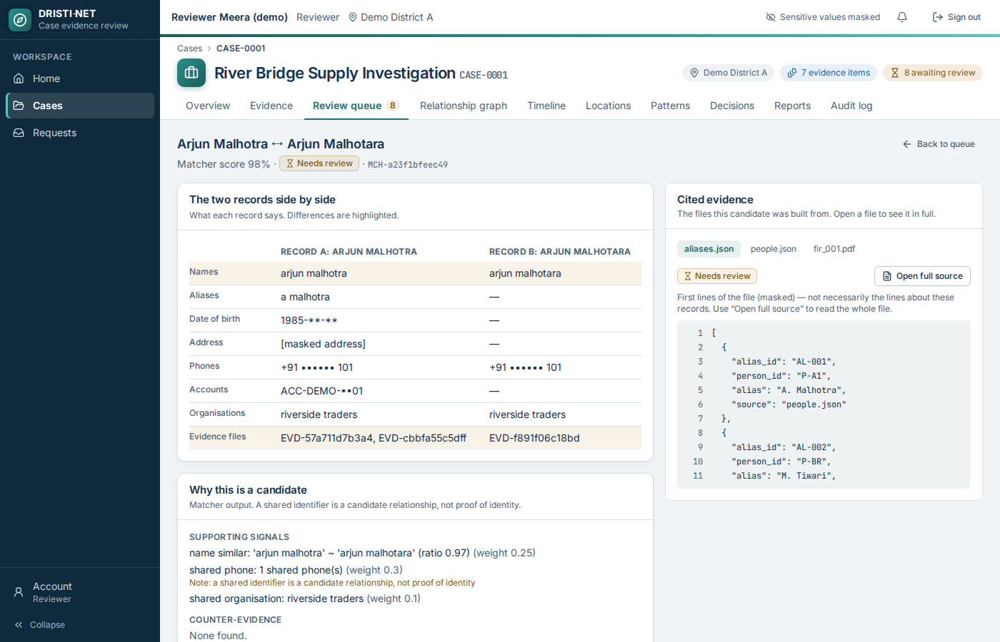 |
| *WebGL-accelerated Sigma.js graph projection with server-side query bounds ($k \le 2$, $N \le 150$, 5s timeout) and instant NetworkX fallback.* | *Conservative entity disambiguation: matches are held for human review with mandatory written rationale logging.* |

| Coordinate-Level Source Lineage Drawer | Evidence Quarantine & Malware Scan Gate |
| :---: | :---: |
| 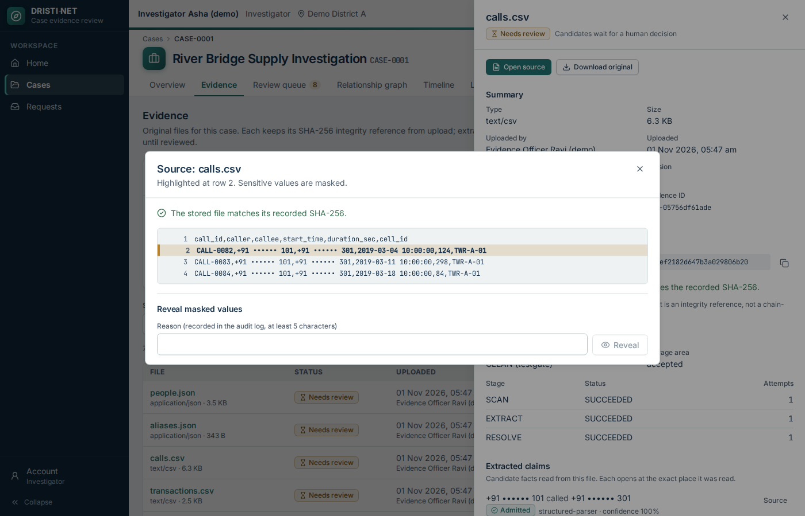 | 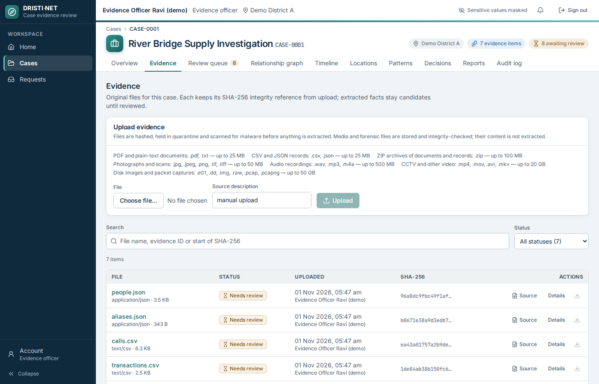 |
| *Direct ground-truth traceability: clicking any graph edge reveals the exact originating line, page number, or table cell.* | *Fail-closed ClamAV antivirus quarantine gate with streaming SHA-256 integrity verification upon upload.* |

| Historical Investigation Timeline | Global Tamper-Evident HMAC Audit Ledger |
| :---: | :---: |
| 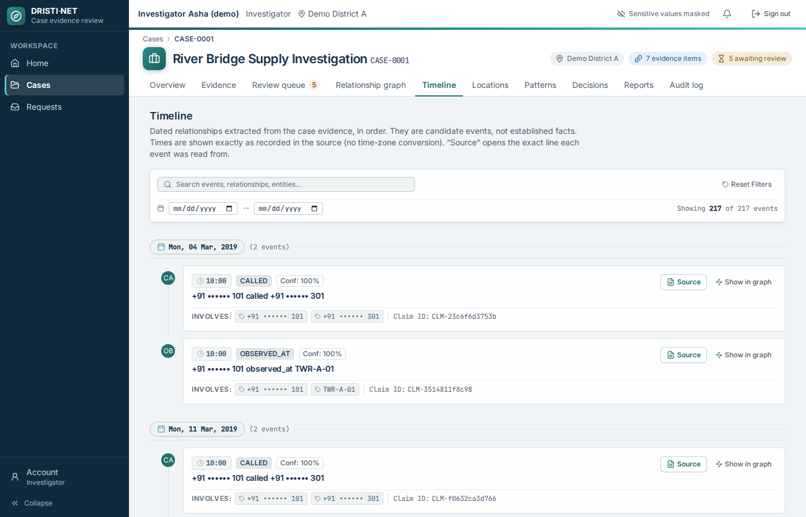 | 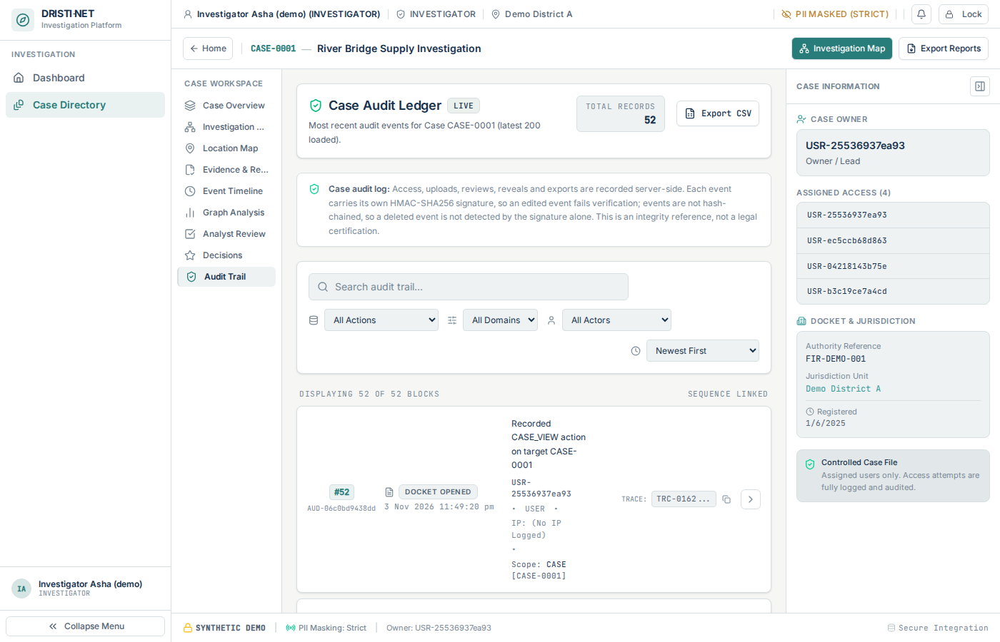 |
| *Temporal decay visualization modeling communication recency while preserving immutable historical records.* | *Append-only cryptographic audit trail with HMAC-SHA256 signature chaining and UTC timestamp pinning.* |

| Court-Admissible Dossier Export | Temporal Network Bridge & Metric Analysis |
| :---: | :---: |
| 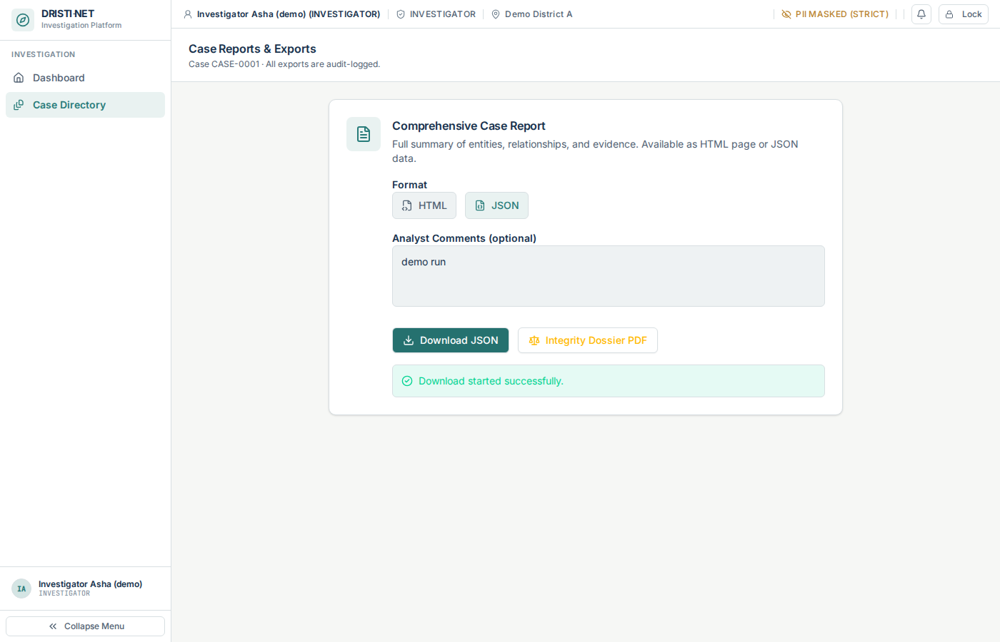 | 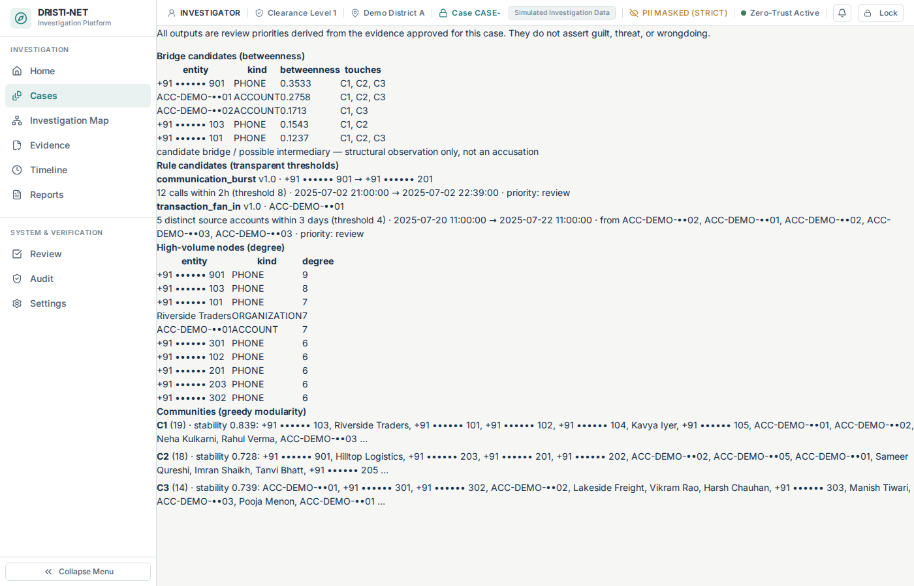 |
| *Export formatted evidence dossiers under BSA 2023 §63(4)(c) / Indian Evidence Act Section 65B.* | *Analytical graph metrics: betweenness centrality, possible bridges, and cross-case relationship discovery.* |

---

## System Architecture & Data Flow

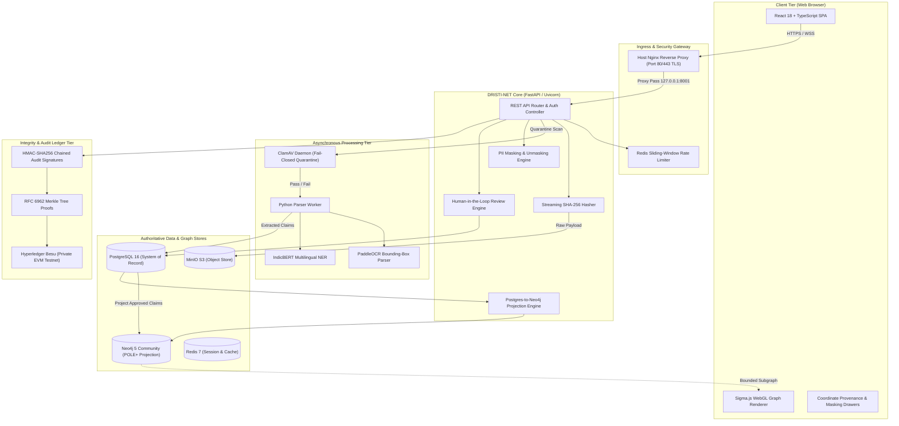

---

## Evidence Lifecycle & State Machine

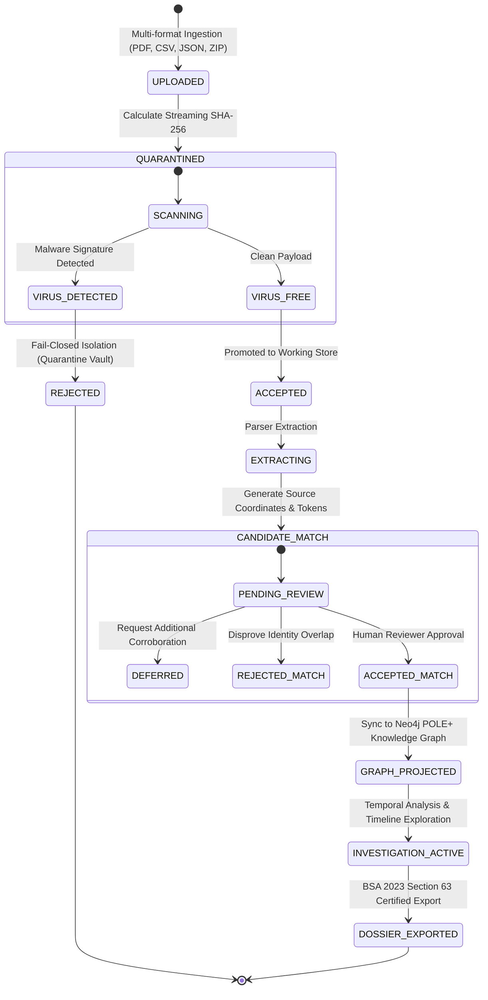

---

## Human-in-the-Loop Disambiguation Flow

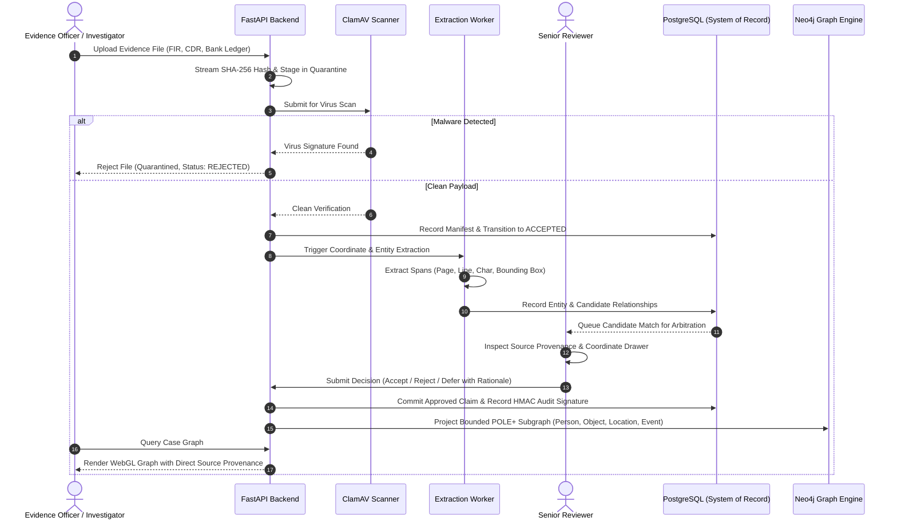

---

## 1. Universal One-Line Quickstart (All Devices)

Deploy DRISTI-NET on **any machine or operating system** with a single command. The installer automatically probes hardware requirements (CPU, RAM, disk space), discovers network interfaces (Localhost, LAN, WAN), checks toolchain prerequisites (Docker, Python, Node), initializes cryptographic secrets, starts all services, runs database migrations, seeds synthetic cases, and launches the web interface in your default browser.

### Linux / macOS / Windows WSL
```bash
curl -fsSL https://raw.githubusercontent.com/vyber07/DRISTI-NET/main/quickstart.sh | bash
```

### Windows Native PowerShell
```powershell
irm https://raw.githubusercontent.com/vyber07/DRISTI-NET/main/quickstart.ps1 | iex
```

### From Local Clone
```bash
git clone https://github.com/vyber07/DRISTI-NET.git && cd DRISTI-NET

# On Linux / macOS / WSL:
./quickstart.sh

# On Windows PowerShell:
powershell .\quickstart.ps1

# Or via Makefile:
make quickstart
```

#### Installer Capabilities:
- **Network Interface & IP Discovery:** Automatically identifies Localhost (`127.0.0.1`), LAN IP (`192.168.x.x` / `172.31.x.x`), and Public WAN IP (with a 2-second timeout for offline/private network safety).
- **Host Binding Choice:** Explicitly asks whether to bind to **Localhost Only** (`127.0.0.1`, safe default) or **All Interfaces** (`0.0.0.0`, network/public access).
- **Data Seeding Confirmation:** Prompts to insert pre-configured synthetic investigation cases and demo user accounts (`[Y/n]`).
- **Headless & Private Network Safe:** Detects non-interactive environments (`--non-interactive` or `-y`) and never blocks on isolated or air-gapped networks.

---

## 2. Multi-Service Architecture & Port Mappings

DRISTI-NET is organized into decoupled, production-ready microservices managed via Docker Compose:

| Host Port | Container Port | Service Name | Technology | Responsibility |
|---|---|---|---|---|
| **`443`** | `8000/tcp` | `api` | FastAPI / Uvicorn | REST API backend & static Web SPA delivery. |
| **`80`** | `80/tcp` | `nginx` | Nginx 1.27 | Reverse proxy enforcing HTTP $\rightarrow$ HTTPS 301 redirect. |
| **`127.0.0.1:8001`** | `8000/tcp` | `api` (direct) | Uvicorn ASGI | Local loopback gateway for backend services. |
| **`127.0.0.1:5432`** | `5432/tcp` | `postgres` | PostgreSQL 16 | Relational System of Record (cases, entities, auth, audit ledger). |
| **`127.0.0.1:9000`** | `9000/tcp` | `minio` | MinIO S3 | Object storage for original evidence files and raw attachments. |
| *(Internal)* | `7474`, `7687` | `neo4j` | Neo4j 5 Community | POLE+ analytical knowledge graph projection and Cypher queries. |
| *(Internal)* | `6379` | `redis` | Redis 7 Alpine | High-speed cache, session tracking, and sliding-window rate limiting. |
| *(Internal)* | `3310` | `clamav` | ClamAV Daemon | Antivirus and malware quarantine scanning engine. |
| *(Internal)* | `9092` | `kafka` | Apache Kafka 3.5 | Asynchronous streaming event broker and pipeline queue. |
| *(Internal)* | `8545` | `besu` | Hyperledger Besu | Private EVM testnet for cryptographic audit hash anchoring. |
| *(Internal)* | `8000` | `worker` | Python Celery/RQ | Background daemon for OCR processing and entity extraction. |

---

## 3. Role-Based Access Control & Demo Accounts

DRISTI-NET implements role-based access control (RBAC) reflecting statutory investigation workflows. Pre-configured demo accounts are provided for demonstration and testing:

| Username | Role | Primary Capabilities & Permissions |
|---|---|---|
| **`investigator`** | `INVESTIGATOR` | Browse assigned cases, explore POLE+ knowledge graph, view timeline, request PII unmasking. |
| **`officer`** | `EVIDENCE_OFFICER` | Ingest digital evidence, inspect SHA-256 integrity manifests, review quarantine scan results. |
| **`reviewer`** | `REVIEWER` | Arbitrate entity match candidates (Accept, Reject, Defer) with mandatory rationale logging. |
| **`analyst`** | `ANALYST` | Graph centrality analysis, temporal network slicing, cross-case relationship discovery. |
| **`auditor`** | `AUDITOR` | Inspect global immutable audit ledger, verify HMAC cryptographic signatures, export compliance reports. |
| **`admin`** | `ADMIN` | User administration, case reassignment, permission overrides, system health monitoring. |

> **Password Convention:** For all demo accounts, the password is `<username>-demo` (e.g. `investigator-demo`, `admin-demo`).

---

## 4. Local Development (Zero-Docker Prototype)

Run DRISTI-NET locally with minimal prerequisites (Python 3.11+ and Node.js 20+):

```bash
# 1. Clone repository
git clone https://github.com/vyber07/DRISTI-NET.git && cd DRISTI-NET

# 2. Set up Python virtual environment & install dependencies
python3 -m venv .venv && source .venv/bin/activate
pip install -r apps/api/requirements.txt
pip install -r apps/api/requirements-dev.txt

# 3. Generate synthetic data & seed local SQLite database
python3 data/synthetic/generate.py
export DRISHTI_SECRET_KEY=$(python3 -c "import secrets; print(secrets.token_hex(32))")
python3 -m apps.api.app.seed --ingest

# 4. Install frontend dependencies & build React SPA
cd apps/web
npm install
npm run build
cd ../..

# 5. Start Backend API & SPA server
python3 -m uvicorn apps.api.app.main:app --host 127.0.0.1 --port 8000 --reload
```
Navigate to [http://localhost:8000](http://localhost:8000) and sign in as `investigator` / `investigator-demo`.

---

## 5. Production Stack Deployment (Docker Compose)

For high-concurrency production deployments with PostgreSQL, Neo4j, MinIO, Redis, and ClamAV:

```bash
# 1. Initialize environment configuration
cp .env.example .env && chmod 600 .env

# 2. Build and launch all production containers
docker compose up -d

# 3. Apply schema migrations & seed default data
docker compose exec -T -w /app/apps/api api alembic upgrade head
docker compose exec -T api python3 -m apps.api.app.seed

# 4. Verify service health
curl -s http://localhost:8001/api/v1/health
```

### Stack Management Shortcuts
```bash
make deploy          # Start full compose stack
make deploy-status   # Display health status of all containers
make deploy-logs     # Stream live logs from API service
make deploy-restart  # Rolling restart without data volume loss
make deploy-down     # Stop stack while preserving databases
```

---

## 6. Test & Verification Suite

DRISTI-NET maintains rigorous test coverage spanning unit, security, integration, and UI accessibility tests:

```bash
# Run backend test suite (540+ tests)
pytest apps/api/app/tests -v

# Run security, tamper-gate, and quarantine scanner tests
pytest apps/api/app/tests/test_security.py -v
pytest apps/api/app/tests/test_archive_uploads.py -v
pytest apps/api/app/tests/test_extraction_failures.py -v

# Run frontend typecheck and bundle build verification
cd apps/web && npm run typecheck && npm run build

# Run end-to-end browser walkthrough (Playwright)
make e2e
```

---

## 7. Authoritative Central Memory & Documentation Map

The [`memory/`](file:///home/ubuntu/DRISTI-NET/memory/README.md) directory serves as the centralized, authoritative technical source of truth for the platform:

| Canonical Directory | Contents & Documentation |
|---|---|
| [`01_project_overview/`](file:///home/ubuntu/DRISTI-NET/memory/01_project_overview/) | [PROJECT_OVERVIEW.md](file:///home/ubuntu/DRISTI-NET/memory/01_project_overview/PROJECT_OVERVIEW.md), [REQUIREMENTS.md](file:///home/ubuntu/DRISTI-NET/memory/01_project_overview/REQUIREMENTS.md), [FEATURE_CATALOG.md](file:///home/ubuntu/DRISTI-NET/memory/01_project_overview/FEATURE_CATALOG.md) |
| [`02_architecture/`](file:///home/ubuntu/DRISTI-NET/memory/02_architecture/) | [SYSTEM_DESIGN.md](file:///home/ubuntu/DRISTI-NET/memory/02_architecture/SYSTEM_DESIGN.md), [ARCHITECTURE_DECISIONS.md](file:///home/ubuntu/DRISTI-NET/memory/02_architecture/ARCHITECTURE_DECISIONS.md) (ADR 001–021) |
| [`03_technical_documentation/`](file:///home/ubuntu/DRISTI-NET/memory/03_technical_documentation/) | [BACKEND.md](file:///home/ubuntu/DRISTI-NET/memory/03_technical_documentation/BACKEND.md), [FRONTEND.md](file:///home/ubuntu/DRISTI-NET/memory/03_technical_documentation/FRONTEND.md), [API_REFERENCE.md](file:///home/ubuntu/DRISTI-NET/memory/03_technical_documentation/API_REFERENCE.md), [DATABASE.md](file:///home/ubuntu/DRISTI-NET/memory/03_technical_documentation/DATABASE.md), [GRAPH_ENGINE.md](file:///home/ubuntu/DRISTI-NET/memory/03_technical_documentation/GRAPH_ENGINE.md) |
| [`04_security_and_governance/`](file:///home/ubuntu/DRISTI-NET/memory/04_security_and_governance/) | [SECURITY_ARCHITECTURE.md](file:///home/ubuntu/DRISTI-NET/memory/04_security_and_governance/SECURITY_ARCHITECTURE.md), [ACCESS_CONTROL.md](file:///home/ubuntu/DRISTI-NET/memory/04_security_and_governance/ACCESS_CONTROL.md), [EVIDENCE_INTEGRITY.md](file:///home/ubuntu/DRISTI-NET/memory/04_security_and_governance/EVIDENCE_INTEGRITY.md) |
| [`05_deployment_and_operations/`](file:///home/ubuntu/DRISTI-NET/memory/05_deployment_and_operations/) | [DEPLOYMENT_GUIDE.md](file:///home/ubuntu/DRISTI-NET/memory/05_deployment_and_operations/DEPLOYMENT_GUIDE.md), [DOCKER_INFRASTRUCTURE.md](file:///home/ubuntu/DRISTI-NET/memory/05_deployment_and_operations/DOCKER_INFRASTRUCTURE.md), [BACKUP_AND_RECOVERY.md](file:///home/ubuntu/DRISTI-NET/memory/05_deployment_and_operations/BACKUP_AND_RECOVERY.md) |
| [`06_testing_and_quality/`](file:///home/ubuntu/DRISTI-NET/memory/06_testing_and_quality/) | [TESTING_STRATEGY.md](file:///home/ubuntu/DRISTI-NET/memory/06_testing_and_quality/TESTING_STRATEGY.md), [TEST_CATALOG.md](file:///home/ubuntu/DRISTI-NET/memory/06_testing_and_quality/TEST_CATALOG.md), [QUALITY_GATES.md](file:///home/ubuntu/DRISTI-NET/memory/06_testing_and_quality/QUALITY_GATES.md) |
| [`07_audits_and_reports/`](file:///home/ubuntu/DRISTI-NET/memory/07_audits_and_reports/) | [AUDIT_INDEX.md](file:///home/ubuntu/DRISTI-NET/memory/07_audits_and_reports/AUDIT_INDEX.md), [CONSOLIDATED_AUDIT_FINDINGS.md](file:///home/ubuntu/DRISTI-NET/memory/07_audits_and_reports/CONSOLIDATED_AUDIT_FINDINGS.md), [master_cleanup_20261119/](file:///home/ubuntu/DRISTI-NET/memory/07_audits_and_reports/master_cleanup_20261119/) |
| [`08_project_history/`](file:///home/ubuntu/DRISTI-NET/memory/08_project_history/) | [DEVELOPMENT_HISTORY.md](file:///home/ubuntu/DRISTI-NET/memory/08_project_history/DEVELOPMENT_HISTORY.md), [COMPLETED_WORK.md](file:///home/ubuntu/DRISTI-NET/memory/08_project_history/COMPLETED_WORK.md) |
| [`09_research_and_references/`](file:///home/ubuntu/DRISTI-NET/memory/09_research_and_references/) | [RESEARCH_PAPERS.md](file:///home/ubuntu/DRISTI-NET/memory/09_research_and_references/), [REGULATORY_FRAMEWORKS.md](file:///home/ubuntu/DRISTI-NET/memory/09_research_and_references/) |
| [`10_source_code_reference/`](file:///home/ubuntu/DRISTI-NET/memory/10_source_code_reference/) | [SOURCE_SNAPSHOTS/](file:///home/ubuntu/DRISTI-NET/memory/10_source_code_reference/SOURCE_SNAPSHOTS/) (Archived baseline implementations) |
| [`11_project_tracking/`](file:///home/ubuntu/DRISTI-NET/memory/11_project_tracking/) | [ROADMAP.md](file:///home/ubuntu/DRISTI-NET/memory/11_project_tracking/ROADMAP.md), [DECISION_LOG.md](file:///home/ubuntu/DRISTI-NET/memory/11_project_tracking/DECISION_LOG.md), [CONTINUATION_STATE.md](file:///home/ubuntu/DRISTI-NET/memory/11_project_tracking/CONTINUATION_STATE.md) |
| [`12_original_references/`](file:///home/ubuntu/DRISTI-NET/memory/12_original_references/) | Historical snapshots and legacy documentation manifests |

---

## 8. Statutory Compliance, Ethics & Safety

- **Synthetic Data Mandate:** All demo cases, identities, phone numbers, and bank transactions are algorithmically generated synthetic data. Real personal identifying information is strictly prohibited in demonstration environments.
- **Statutory Evidentiary Standard:** Hash manifests, Merkle inclusion proofs, and dossier exports provide technical proof of electronic record integrity under Indian Bharatiya Sakshya Adhiniyam (BSA) 2023 Section 63(4)(c) / Indian Evidence Act Section 65B. Technical integrity does not independently establish substantive factual guilt.
- **Air-Gapped & Sovereign Deployment:** The platform does not require external cloud connections to function. All entity extraction, malware analysis, and graph calculations can execute entirely within a self-hosted, sovereign on-premises infrastructure.
- **Neutral Evidentiary Language:** The platform strictly enforces neutral language across all UI views and exports: *candidate relationship*, *possible bridge*, *review priority*, *integrity reference*. Conclusory terms like *criminal*, *kingpin*, or *guilt* are architecturally forbidden.

---

## License & Terms of Use

DRISTI-NET is licensed under the **Proprietary Non-Commercial Source-Available License (Version 1.0)**.

- **Permitted Uses:** Academic research, educational study, peer review, independent security evaluation, and non-commercial local testing with synthetic data.
- **Prohibited Uses:** Commercial exploitation, commercial SaaS/cloud hosting, paid consulting services, or embedding in proprietary software without an explicit commercial license agreement.

See the full terms and conditions in [`LICENSE`](file:///home/ubuntu/DRISTI-NET/LICENSE).
