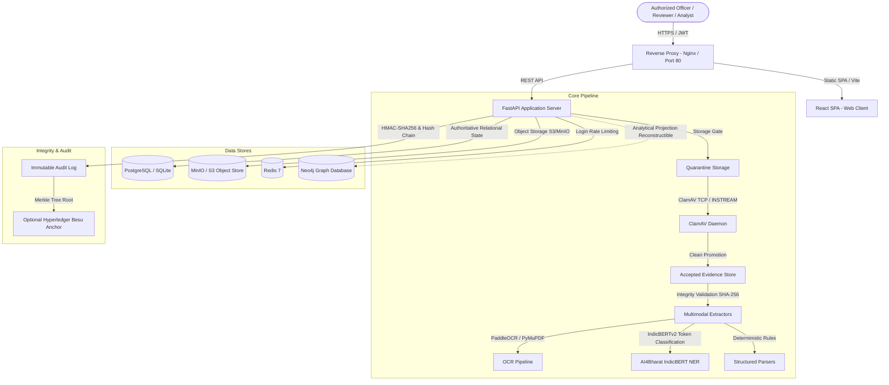

# DRISTI-NET — Architecture Overview

## 1. System Mission & Identity

DRISTI-NET is an evidence-first, multimodal investigation and relationship-intelligence platform designed for authorized law enforcement and investigative agencies.

Its primary purpose is to provide an auditable, verifiable environment for:
- Digital evidence ingestion, isolation, and integrity verification.
- Document and media processing (OCR, structured extraction, NER).
- Entity candidate proposition and resolution.
- Human-in-the-loop (HITL) review and decision capture.
- Temporal and analytical graph exploration.
- Tamper-evident audit logging and electronic evidence dossier generation under BSA s.63 / IEA s.65B.

**Fundamental Boundary**: DRISTI-NET is an analytical and evidentiary support system. It strictly produces *candidate relationships*, *possible bridges*, *review priorities*, and *integrity references*. It never autonomously determines guilt, establishes statutory identity, or executes judicial enforcement actions.

---

## 2. Architecture Topology

---

## 3. Authoritative vs Reconstructible Stores

| Component | Nature | Role in System | Disaster Recovery / Loss Impact |
|-----------|--------|----------------|---------------------------------|
| **PostgreSQL / SQLite** | Authoritative | Canonical record of users, cases, evidence metadata, claims, provenance, match candidates, reviews, and audit events. | Zero loss tolerance. Backed up via WAL / snapshots. |
| **MinIO / S3 Storage** | Authoritative | Raw ingested byte-exact artifacts. Immutable once accepted. Verified via SHA-256 manifests. | Zero loss tolerance. Object versioning and replication. |
| **Neo4j** | Reconstructible Projection | Graph database optimizing hop-constrained path queries, centrality, and neighborhood analysis. | Can be rebuilt 100% from PostgreSQL claims at any time via projection replay. |
| **Redis** | Ephemeral Cache | IP and account login rate-limiting (`LOGIN_THROTTLE`). | Loss triggers clean cold-start with zero data compromise. |

---

## 4. Evidence State Governance Model

Evidence proceeds through an internal 6-stage governance lifecycle:

1. **QUARANTINED**: Object received and written to isolated storage; SHA-256 calculated. Not accessible by analytical pipelines.
2. **MALWARE_SCANNING**: Active scan via ClamAV daemon (`INSTREAM` protocol) or verified testgate.
3. **ACCEPTED**: Passed anti-malware verification. Moved to accepted storage area with verified immutable hash.
4. **PROCESSING**: Parser execution (OCR text extraction, IndicBERT NER, regex extraction).
5. **HITL / CANDIDATES**: Entity candidates generated; pending mandatory human supervisor sign-off.
6. **GRAPH_PROJECTED / ACTIVE**: Review decisions committed to authoritative audit log; projected to graph views.

---

## 5. Security and Compliance Tenets

- **Fail-Closed Malware Gate**: Any scan failure, timeout, or scanner unavailability keeps the object in quarantine.
- **Case Isolation**: User jurisdiction and explicit case assignment strictly verified at the database query level on every API call.
- **PII Masking by Default**: Phone numbers, accounts, and national IDs masked in UI and API responses unless explicitly unmasked under audited justification.
- **Cryptographic Audit Chain**: Every supervisory decision, file promotion, unmasking event, and report generation is signed with HMAC-SHA256 and chained to previous events.
