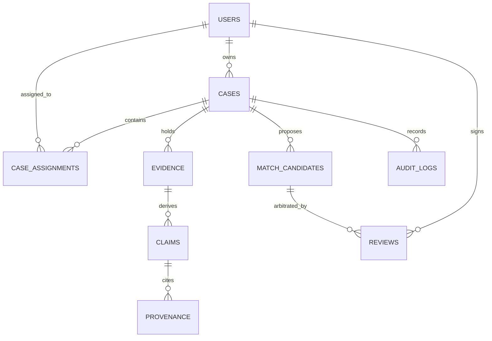

# DRISTI-NET — Database Architecture & Schema Specification

## 1. Relational Database Schema (PostgreSQL Authoritative)

The relational database serves as the single source of truth for all case data, evidence metadata, extraction claims, provenance, user access control, and immutable audit logs.

### 1.1 Core Entity-Relationship Diagram

### 1.2 Table Specifications

#### `users`
- `user_id` (VARCHAR PK): Unique user identifier (`USR-...`).
- `username` (VARCHAR UNIQUE): Login username.
- `password_hash` (VARCHAR): Argon2/PBKDF2/bcrypt hash.
- `display_name` (VARCHAR): Full human name with rank/designation.
- `role` (VARCHAR): Enum (`ADMIN`, `INVESTIGATOR`, `EVIDENCE_OFFICER`, `REVIEWER`, `ANALYST`, `AUDITOR`, `UNASSIGNED`).
- `jurisdiction` (VARCHAR): Statutory jurisdiction boundary (e.g. `Demo District A`).
- `is_active` (BOOLEAN): Soft-disable flag.

#### `cases`
- `case_id` (VARCHAR PK): Case reference identifier (`CASE-...`).
- `title` (VARCHAR): Descriptive case docket title.
- `jurisdiction` (VARCHAR): Statutory jurisdiction owning this case.
- `purpose` (VARCHAR): Mandatory statutory investigative mandate.
- `authority_reference` (VARCHAR): Statutory FIR or Court Reference number.
- `classification` (VARCHAR): Security tier (`SYNTHETIC_DEMO`, `OFFICIAL`, `RESTRICTED`, `CONFIDENTIAL`).
- `sensitivity` (VARCHAR): Data classification tier (`STANDARD`, `SENSITIVE`, `CRITICAL`).
- `owner_id` (VARCHAR FK -> users.user_id).
- `created_at` (TIMESTAMP): Docket creation timestamp.

#### `evidence`
- `evidence_id` (VARCHAR PK): Cryptographic evidence identifier (`EVD-...`).
- `case_id` (VARCHAR FK -> cases.case_id): Owning case.
- `filename` (VARCHAR): Original uploaded file name.
- `extension` (VARCHAR): File extension (`.csv`, `.json`, `.pdf`, `.txt`, `.zip`).
- `size_bytes` (INTEGER): File size.
- `sha256` (VARCHAR): Canonical SHA-256 hex digest computed at quarantine entry.
- `status` (VARCHAR): Governance state (`UPLOADED`, `QUARANTINED`, `MALWARE_SCANNING`, `ACCEPTED`, `PROCESSING`, `EXTRACTED`, `ENTITY_CANDIDATES`, `HITL`, `GRAPH_PROJECTED`, `INFECTED`, `INTEGRITY_MISMATCH`, `EXTRACTION_FAILED`).
- `storage_path` (VARCHAR): MinIO object key or relative filesystem path.
- `classification`, `jurisdiction`, `purpose`, `access_class`: Mirrored from case at acceptance time.
- **Constraint**: `uix_evidence_case_sha` (`case_id`, `sha256`) preventing duplicate submissions within a case.

#### `entities` & `claims`
- `entities`: Deduplicated canonical registry across cases (`entity_id`, `kind`, `canonical`, `label`, `attributes`, `access_class`).
- `claims`: Fact statements asserted by evidence (`claim_id`, `case_id`, `evidence_id`, `kind`, `rel_type`, `source_entity_id`, `target_entity_id`, `attribute`, `original_value`, `normalized_value`, `confidence`, `weight`, `state`, `flags`).
- `provenance`: Exact micro-locators (`claim_id`, `evidence_id`, `locator`, `snippet`, `method`, `method_version`).

#### `match_candidates` & `reviews`
- `match_candidates`: Proposed entity candidate relationships (`candidate_id`, `case_id`, `left_entity_id`, `right_entity_id`, `confidence`, `positive_signals`, `counter_evidence`, `conflicts`, `missing`, `state`).
- `reviews`: Immutable supervisory sign-off entries (`review_id`, `candidate_id`, `reviewer_id`, `decision`, `justification`, `created_at`).

#### `audit_logs`
- `audit_id` (VARCHAR PK): Unique event identifier.
- `case_id` (VARCHAR): Case scope.
- `actor_id` (VARCHAR): Acting officer user ID.
- `action` (VARCHAR): Action enum (`CASE_VIEW`, `EVIDENCE_UPLOAD`, `SCAN_RESULT`, `EXTRACTED`, `CANDIDATES_GENERATED`, `HITL_DECISION`, `UNMASK`, `REPORT_EXPORT`).
- `target_type`, `target_id`: Domain target.
- `outcome` (VARCHAR): `OK`, `BLOCKED`, `ERROR`.
- `detail` (JSON): Context parameters.
- `prev_hash` (VARCHAR): Cryptographic pointer to preceding audit log event.
- `signature` (VARCHAR): HMAC-SHA256 signature generated using active key (`k1-2026`).
