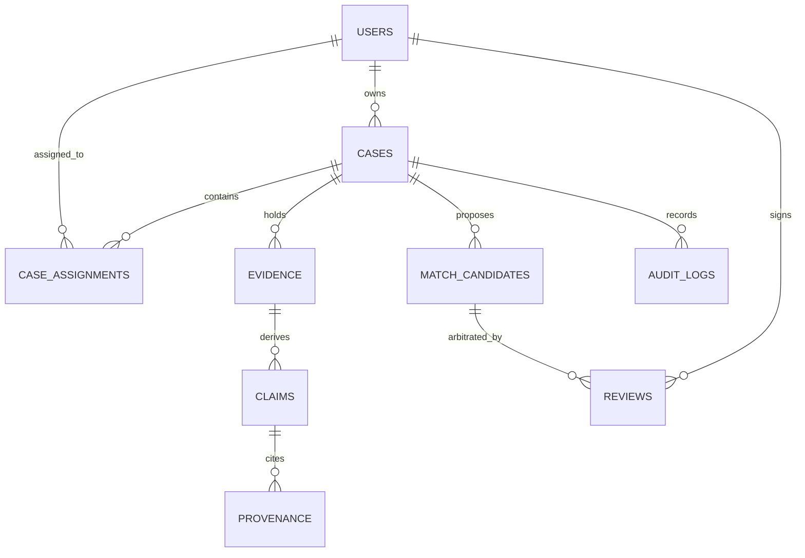

# DRISTI-NET — Database Architecture & Schema Specification

## 1. Relational Database Schema (PostgreSQL Authoritative)

The relational database serves as the single source of truth for all case data, evidence metadata, extraction claims, provenance, user access control, and immutable audit logs.

### 1.1 Core Entity-Relationship Diagram

### 1.2 Table Specifications

#### `users`
- `user_id` (VARCHAR PK): Unique user identifier (`USR-...`).
- `username` (VARCHAR UNIQUE): Login username.
- `password_hash` (VARCHAR): Argon2/PBKDF2/bcrypt hash.
- `display_name` (VARCHAR): Full human name with rank/designation.
- `role` (VARCHAR): Enum (`ADMIN`, `INVESTIGATOR`, `EVIDENCE_OFFICER`, `REVIEWER`, `ANALYST`, `AUDITOR`, `UNASSIGNED`).
- `jurisdiction` (VARCHAR): Statutory jurisdiction boundary (e.g. `Demo District A`).
- `is_active` (BOOLEAN): Soft-disable flag.

#### `cases`
- `case_id` (VARCHAR PK): Case reference identifier (`CASE-...`).
- `title` (VARCHAR): Descriptive case docket title.
- `jurisdiction` (VARCHAR): Statutory jurisdiction owning this case.
- `purpose` (VARCHAR): Mandatory statutory investigative mandate.
- `authority_reference` (VARCHAR): Statutory FIR or Court Reference number.
- `classification` (VARCHAR): Security tier (`SYNTHETIC_DEMO`, `OFFICIAL`, `RESTRICTED`, `CONFIDENTIAL`).
- `sensitivity` (VARCHAR): Data classification tier (`STANDARD`, `SENSITIVE`, `CRITICAL`).
- `owner_id` (VARCHAR FK -> users.user_id).
- `created_at` (TIMESTAMP): Docket creation timestamp.

#### `evidence`
- `evidence_id` (VARCHAR PK): Cryptographic evidence identifier (`EVD-...`).
- `case_id` (VARCHAR FK -> cases.case_id): Owning case.
- `filename` (VARCHAR): Original uploaded file name.
- `extension` (VARCHAR): File extension (`.csv`, `.json`, `.pdf`, `.txt`, `.zip`).
- `size_bytes` (INTEGER): File size.
- `sha256` (VARCHAR): Canonical SHA-256 hex digest computed at quarantine entry.
- `status` (VARCHAR): Governance state (`UPLOADED`, `QUARANTINED`, `MALWARE_SCANNING`, `ACCEPTED`, `PROCESSING`, `EXTRACTED`, `ENTITY_CANDIDATES`, `HITL`, `GRAPH_PROJECTED`, `INFECTED`, `INTEGRITY_MISMATCH`, `EXTRACTION_FAILED`).
- `storage_path` (VARCHAR): MinIO object key or relative filesystem path.
- `classification`, `jurisdiction`, `purpose`, `access_class`: Mirrored from case at acceptance time.
- **Constraint**: `uix_evidence_case_sha` (`case_id`, `sha256`) preventing duplicate submissions within a case.

#### `entities` & `claims`
- `entities`: Deduplicated canonical registry across cases (`entity_id`, `kind`, `canonical`, `label`, `attributes`, `access_class`).
- `claims`: Fact statements asserted by evidence (`claim_id`, `case_id`, `evidence_id`, `kind`, `rel_type`, `source_entity_id`, `target_entity_id`, `attribute`, `original_value`, `normalized_value`, `confidence`, `weight`, `state`, `flags`).
- `provenance`: Exact micro-locators (`claim_id`, `evidence_id`, `locator`, `snippet`, `method`, `method_version`).

#### `match_candidates` & `reviews`
- `match_candidates`: Proposed entity candidate relationships (`candidate_id`, `case_id`, `left_entity_id`, `right_entity_id`, `confidence`, `positive_signals`, `counter_evidence`, `conflicts`, `missing`, `state`).
- `reviews`: Immutable supervisory sign-off entries (`review_id`, `candidate_id`, `reviewer_id`, `decision`, `justification`, `created_at`).

#### `audit_events` (append-only; ADR-013, docs/AUDIT_LOG_POLICY.md)
Corrected 2026-11-12: this section previously named the table `audit_logs` and listed a `prev_hash` chain column. Neither
exists. Integrity comes from per-row signatures, database triggers and daily digests.
- `audit_id` (VARCHAR PK), `trace_id` (server request ID), `correlation_id` (validated client value).
- `actor_id`, `actor_username`, `actor_role`, `office_id` (the actor's verified office), `session_id`.
- `action`, `target_kind`, `target_id`, `case_id`, `resource_office` (the case's jurisdiction).
- `outcome` (`OK`, `DENIED`, `ERROR`), `failure_reason`, `detail` (JSON, redacted).
- `ip_address` (trusted-proxy aware), `user_agent` (sanitised), `created_at` (UTC).
- `signature`: `key_id:hmac-sha256-json-v2:hex` over every field. Older algorithms still verify.
- Triggers refuse UPDATE and DELETE (PostgreSQL also TRUNCATE).

#### `users` (additional columns)
- `active` (BOOLEAN; the earlier `is_active` name in this document was wrong), `token_version` (INTEGER, bumped on
  password reset), `office_id` (VARCHAR, verified organisational office, assigned by an administrator).
- `org_user_id` (VARCHAR NULL, unique `uq_users_org_user_id`; migration `5bcde1234577`): the organisational user ID
  allocated by an administrator and shown as "User ID". `user_id` stays the immutable internal key that every
  foreign key references. NULL = not allocated. See docs/USER_ID_ALLOCATION.md and ADR-019.

#### `org_user_ids` (migration `5bcde1234577`; docs/USER_ID_ALLOCATION.md)
- `assignment_id` (integer PK), `org_user_id` (upper-cased), `user_id` (FK `users`), `status` (`ACTIVE`, `RETIRED`,
  `VOIDED`), `assigned_by` (`user_id` or `SEED`), `assigned_at`, `assign_reason`, `ended_by`, `ended_at`, `end_reason`.
- Partial unique index `uix_org_user_ids_taken (org_user_id) WHERE status IN ('ACTIVE','RETIRED')`: an ID that is or
  was held is never allocated again (only a VOIDED correction frees one). `uix_org_user_ids_active_user (user_id)
  WHERE status = 'ACTIVE'`: one current ID per user.
- Trigger `org_user_ids_guard`: no DELETE (PostgreSQL also TRUNCATE). The only permitted UPDATE ends an ACTIVE row
  (to RETIRED or VOIDED, with `ended_by`, `ended_at` and `end_reason` set, allocation columns unchanged).

#### `user_sessions` (migration `5bcde1234572`)
- `sid` (PK, the token's `sid` claim), `user_id` (FK), `created_at`, `expires_at`, `revoked_at` (set by logout), `ip_address`, `user_agent`.

#### `masking_policies` (migration `5bcde1234573`; docs/MASKING_AUTHORIZATION.md)
- `kind` (PK: `PHONE`, `ACCOUNT`, `PII_ATTRIBUTE`, `EVIDENCE_CONTEXT`, `RAW_FILE`), `reveal_roles` (JSON list; never
  contains `ADMIN`), `updated_at`, `updated_by`, `reason`. A missing row means nobody may reveal that kind.

#### `permission_overrides` (migration `5bcde1234574`; docs/AUTHORIZATION_OVERRIDES.md)
- `override_id` (PK `OVR-...`), `effect` (`ALLOW`/`DENY`), `action`, `subject_type` (`USER`/`ROLE`), `subject`.
- Scope: `case_id` (nullable = all cases), `resource_type` + `resource_id` (nullable = any resource).
- `reason`, `starts_at`, `expires_at` (UTC; at most 90 days apart).
- `status` (`PENDING`, `ACTIVE`, `REJECTED`, `REVOKED`). `SCHEDULED` and `EXPIRED` are derived from the time window, not stored.
- `created_by`, `created_at`, `approved_by`, `approved_at`, `decided_reason`, `revoked_by`, `revoked_at`, `revoke_reason`.
- Rows are never deleted. Indexes on `action`, `subject`, `case_id`, `status`.

#### `upload_policies` (migration `5bcde1234575`; docs/UPLOAD_POLICY.md)
- `category` (PK: `DOCUMENT`, `STRUCTURED`, `ARCHIVE`, `IMAGE`, `AUDIO`, `VIDEO`, `FORENSIC`), `max_mb`, `enabled`,
  `updated_at`, `updated_by`, `reason`. Empty until an administrator sets a limit; a missing row means the environment default.
- `evidence.record_type` gains `image`, `audio`, `video`, `forensic` for stored-only evidence (no claims extracted).

#### `user_requests`, `user_request_events` (append-only), `notifications` (migration `5bcde1234576`; docs/USER_REQUESTS.md)
- `user_requests`:
  - `request_id` (integer PK; shown as `UR-000123`), `category`, `title`, `justification`, `details` (JSON),
    `priority`, `status` (`DRAFT`, `PENDING`, `UNDER_REVIEW`, `APPROVED`, `REJECTED`, `COMPLETED`, `CANCELLED`),
    `dedupe_key`, `requester_id` (FK `users`), `case_id`;
  - `reviewer_id`, `decision_reason`, `decided_at`, `completed_by`, `completed_at`, `completion_note`;
  - `created_at`, `submitted_at`, `updated_at`, `version` (incremented by every change; changes are conditional on it).
- Unique partial index `uix_user_requests_open_dedupe (requester_id, dedupe_key) WHERE status IN (DRAFT, PENDING,
  UNDER_REVIEW, APPROVED)`: no duplicate open requests, even under concurrent creates.
- `user_request_events`: `event_id`, `request_id`, `event`, `from_status`, `to_status`, `actor_id`, `actor_role`, `at`,
  `reason`, `detail`. Triggers refuse UPDATE and DELETE (PostgreSQL also TRUNCATE).
- `notifications`: `notification_id`, `user_id`, `kind`, `title`, `body`, `link`, `request_id`, `created_at`,
  `read_at`. Each user reads only their own.

#### `permission_override_events` (append-only)
- `event_id` (PK), `override_id` (indexed), `event` (`CREATED`, `APPROVED`, `REJECTED`, `REVOKED`), `actor_id`, `at`,
  `reason`, `snapshot` (JSON: the override after the change). Triggers refuse UPDATE and DELETE (PostgreSQL also TRUNCATE).
  Every event is also a signed `OVERRIDE_*` row in `audit_events`.
