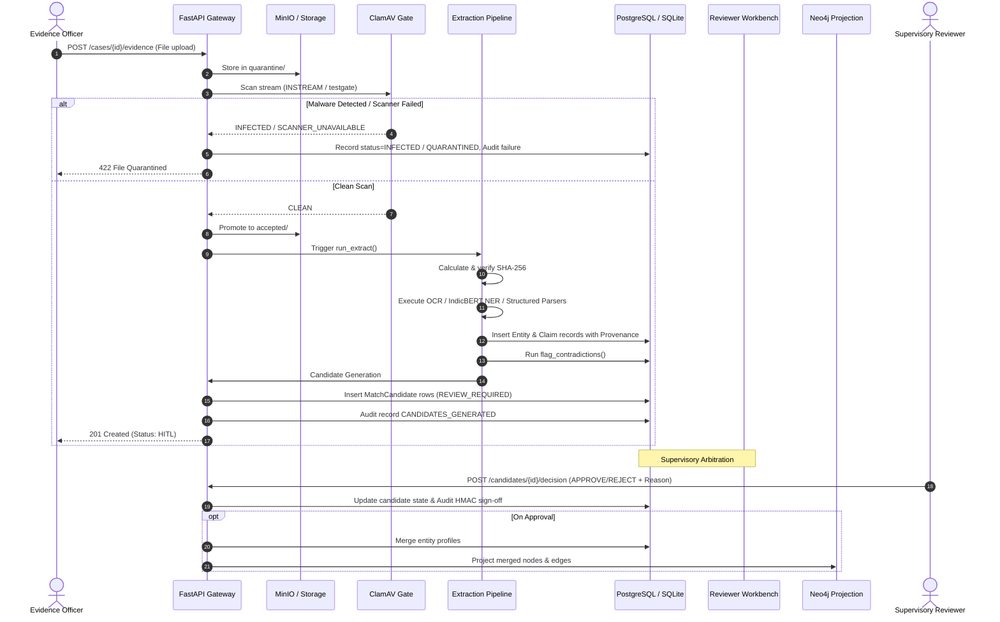

# DRISTI-NET — Data Flow & Lifecycle Architecture

## 1. End-to-End Evidence Ingestion Flow

---

## 2. Claim Provenance & Traceability Flow

Every analytical relationship and entity attribute in DRISTI-NET maintains strict forward and backward traceability:

1. **Source Evidence Object**: Retains raw byte manifest (`sha256`), upload metadata, officer identity, and chain of custody.
2. **Provenance Record**: Contains `locator` payload:
   - Structured tabular (CSV): `{"row": 42, "columns": ["caller", "callee"]}`.
   - Semi-structured (JSON): `{"json_path": "$[12].phone"}`.
   - Unstructured Document (PDF/TXT): `{"page": 2, "line": 14, "char_offset": 850, "engine": "paddleocr"}`.
3. **Claim Record**: Connects source entity, target entity, relationship type (`CALLED`, `OWNS_VEHICLE`, `TRANSFERRED_TO`), weight, temporal timestamp, and missingness metrics.
4. **Graph Node/Edge Inspection**: When an analyst clicks an edge in the Sigma.js canvas:
   - Client calls `GET /api/v1/cases/{id}/edge?source={s}&target={t}&rel_type={r}`.
   - API verifies evidence integrity and retrieves exact source context line.
   - Analyst views byte-for-byte highlighted source text in the Evidence Drawer with verified hash match proof.
