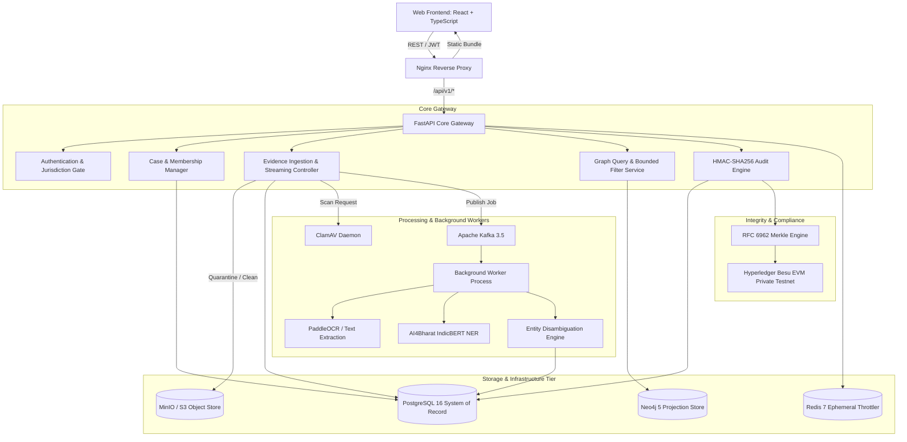

# DRISTI-NET — Master Component Architecture

**Authority:** `docs/SYSTEM_COMPONENTS.md`, `docs/architecture/BASELINE_ARCHITECTURE.md`, `docs/architecture.md`  
**Consolidation Date:** 2026-11-19  

---

## 1. System Component Topology

The system comprises seven primary subsystem tiers:

---

## 2. Component Responsibility Specifications

### 2.1 Web Frontend (`apps/web/`)
- Single-page application using React 18, TypeScript, Tailwind CSS, Vite, and Radix UI primitives.
- State management organized into dedicated Zustand/React stores:
  - `authStore`: JWT token persistence, user profile, role permissions.
  - `caseStore`: Active case context, case selector, member lists.
  - `graphStore`: Active Sigma.js instance, node/edge filters, selection drawer state.
  - `revealStore`: Audited unmasking dialogs and reveal token lifetimes.
  - `uiStore`: Accessibility, sidebar collapse, modal focus trapping.
- **Strict Boundary:** The frontend never connects directly to backend databases, object stores, or graph stores. All data interactions occur strictly via `/api/v1/*` REST endpoints.

### 2.2 FastAPI API Core (`apps/api/app/`)
- Stateless HTTP service adhering to OpenAPI 3.0 specification.
- Routing modules segregated by domain responsibility (`apps/api/app/routes/`):
  - `auth_routes.py`: Login, token refresh, logout.
  - `account_routes.py`: Self-service profile updates, password changes, active session revocation, personal security audit logs.
  - `case_routes.py`: Case creation, search, case team assignment, statistics.
  - `evidence_routes.py`: Chunked streaming upload, quarantine control, file downloads with checksum headers.
  - `review_routes.py`: Candidate pair listings, accept/reject/defer decision endpoints.
  - `graph_routes.py`: Bounded k-hop queries, temporal slice filtering, centrality metrics, location queries.
  - `integrity_routes.py`: Merkle root generation, Besu anchor verification, BSA evidence dossier PDF generation.
  - `audit_routes.py`: Audit trail querying, HMAC chain verification, compliance exports.

### 2.3 Domain Services Layer (`apps/api/app/services/`)
- `storage.py`: Dual-tier storage driver abstraction supporting AWS S3/MinIO APIs and local filesystem storage for isolated unit tests.
- `scanner.py`: Antivirus scanner client with fail-closed semantics. Evaluates ClamAV clamd daemon replies or fallback testgate.
- `extract_document.py`: Multi-format parser engine handling PDFs, CSVs, JSONs, and text files.
- `ocr_adapter.py`: PaddleOCR integration producing coordinate-anchored bounding boxes.
- `nlp_adapter.py`: AI4Bharat IndicBERTv2 NER model extracting Indian names, organizations, and locations.
- `resolution.py`: Deterministic entity disambiguation engine computing positive and negative matching signals.
- `graph.py`: In-process analytical graph projector (NetworkX) computing degrees, betweenness bridges, and temporal decay.
- `neo4j_store.py`: Cypher client projecting relational claims into Neo4j property graph format.
- `integrity.py`: RFC 6962 cryptographic Merkle tree implementation and web3 EVM ledger anchoring client.
- `court_pdf.py`: ReportLab generator producing neutral, court-referenceable PDF evidence dossiers.
- `audit.py`: Append-only audit logger enforcing cryptographic HMAC-SHA256 signature chaining.

### 2.4 Worker Subsystem (`workers/worker.py`)
- Independent background consumer process executing offloaded multimodal extraction and heavy OCR workloads.
- Consumes jobs from Kafka topic `drishti.evidence.jobs` with automatic retries and dead-letter error handling.
