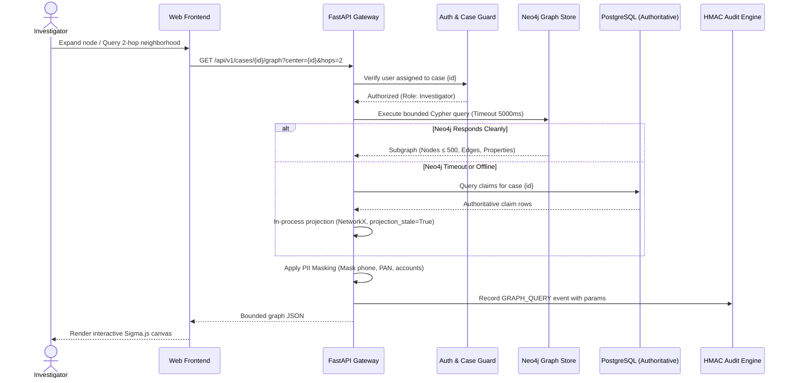

# DRISTI-NET — Master End-to-End Data Flow Specification

**Authority:** `docs/DATA_FLOW.md`, `docs/workflow.md`, `docs/context.md` §6, §8  
**Consolidation Date:** 2026-11-19  

---

## 1. Canonical Ingestion Pipeline

The DRISTI-NET ingestion lifecycle transitions evidence strictly across deterministic, audited states:

```
[Upload Request]
       │
       ▼
1. Validation Gate
   ├── File extension & MIME magic verification
   ├── Size bounds check (MAX_UPLOAD_MB)
   └── Anti-zip bomb / directory traversal check
       │
       ▼
2. Quarantine Ingestion
   ├── Streamed to quarantine storage bucket/folder
   ├── SHA-256 hash calculated simultaneously
   └── Database record created with status: QUARANTINED
       │
       ▼
3. Antivirus Scan Gate (ClamAV)
   ├── Streamed or passed to ClamAV daemon
   ├── Clean? ──► Status: CLEAN (Promoted to accepted storage)
   └── Infected / Timeout / Error? ──► Status: INFECTED / EXTRACTION_FAILED (Stays quarantined, execution halts)
       │
       ▼
4. Multimodal Extraction
   ├── PDF text layer or PaddleOCR text/bbox extraction
   ├── CSV / JSON tabular record parsing
   ├── IndicBERT NER token classification (PERSON, ORG, LOC)
   └── Coordinate provenance anchored for every claim
       │
       ▼
5. Conservative Entity Resolution
   ├── Exact key indexing (Phone, PAN, Aadhaar hash, Account)
   ├── Fuzzy phonetic scoring (Jaro-Winkler)
   ├── Match candidates generated with positive/counter evidence
   └── Placed in HITL Review Queue (Status: REVIEW_REQUIRED)
       │
       ▼
6. Human-in-the-Loop Arbitration
   ├── Reviewer inspects side-by-side evidence
   ├── Decision recorded: ACCEPT, REJECT, or DEFER
   └── Immutable audit log entry generated with user rationale
       │
       ▼
7. Graph Projection
   ├── Approved entities and claims projected to Neo4j
   ├── POLE+ nodes and relationship edges created
   └── Indexed by observed timestamp and temporal decay curves
```

---

## 2. Invariant Evidence States (`models.EVIDENCE_STATES`)

| State | Definition | Permitted Next States |
|---|---|---|
| `QUARANTINED` | Uploaded into isolated quarantine zone; unverified. | `SCANNING`, `REJECTED` |
| `SCANNING` | Active ClamAV malware scan underway. | `CLEAN`, `INFECTED`, `SCAN_FAILED` |
| `INFECTED` | Malware detected; permanently blocked from extraction. | `TOMBSTONED` |
| `SCAN_FAILED` | Scanner timeout, crash, or daemon unavailable; fail-closed. | `SCANNING` (retry) |
| `CLEAN` | Antivirus scan passed; moved to accepted storage. | `EXTRACTING` |
| `EXTRACTING` | OCR, document parsing, and NER underway. | `PROCESSED`, `EXTRACTION_FAILED` |
| `EXTRACTION_FAILED` | Parser syntax error, corrupt archive, or OCR failure; retryable. | `EXTRACTING` (retry) |
| `PROCESSED` | Extraction complete; claims and entities persisted. | `TOMBSTONED` |
| `TOMBSTONED` | Administratively expunged; metadata retained for audit. | Final |

---

## 3. Query & Projection Data Flow


