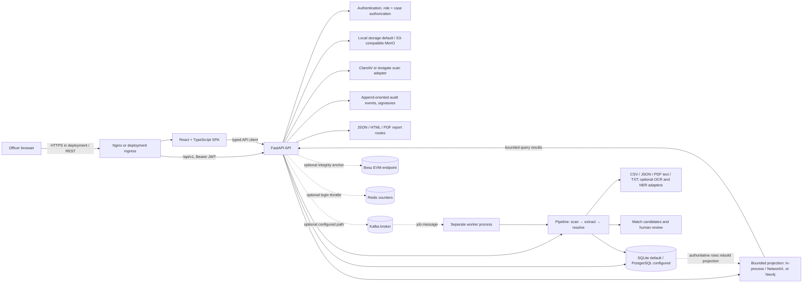
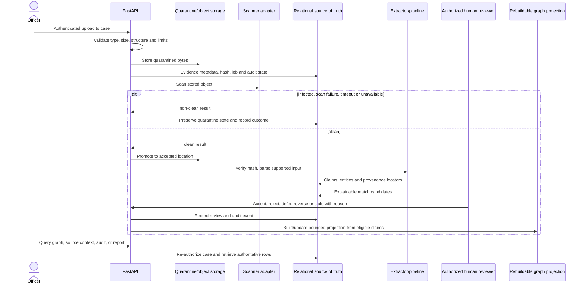
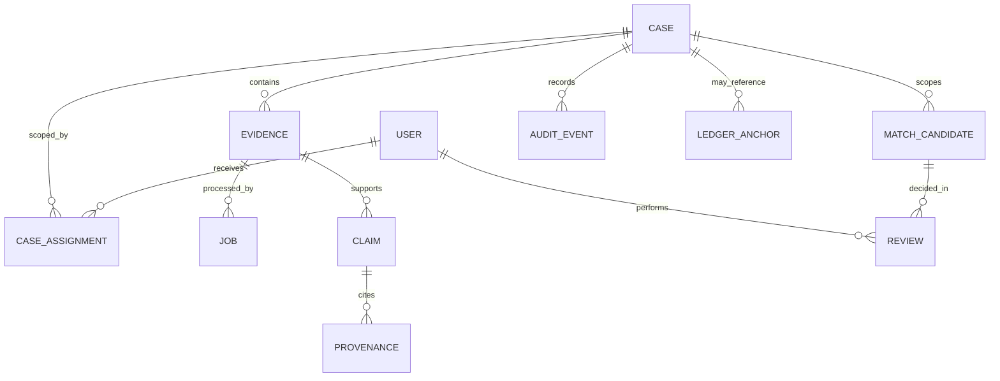

# DRISTI-NET system design memory

**Purpose:** durable project orientation for future contributors. This is a repository-grounded design summary, not an implementation audit, security certification, deployment approval, or substitute for the source of truth.

**Evidence rule:** source/configuration confirms that a path is coded or wired. A behavior is called *demonstrated* only where the cited project status/test records say it was tested. Those records have dates and some disagree. No test suite or live service was run while writing this document. Recheck current code, `docs/status.md`, the relevant test, and deployment state before relying on a claim.

## 1. Product boundaries and intended use

DRISTI-NET is an evidence-linked relationship discovery prototype for authorized retrospective review. Its proper outputs are candidate relationships, possible bridges, review priorities, source provenance, uncertainty, and integrity references. It supports an authorized human investigator's review; it must not infer guilt, make enforcement decisions, autonomously label people, or turn centrality or a shared identifier into proof of identity.

Repository guidance says demo data must be synthetic. The codebase does not establish live access to CCTNS, ICJS, telecom, banking, CCTV, biometric, intelligence, or other government systems. Any future connector requires explicit authorization, documented data contracts, security review, and end-to-end verification.

## 2. Current system shape

### Runtime and processing topology

The browser talks to the API; it is not supposed to query a database, object store, Neo4j, Kafka, Redis, or Besu directly. `apps/api/app/main.py` mounts domain routers under `/api/v1`, applies trace/security headers and exception handling, and serves the web build if configured. In SQLite mode it also mounts demo routes. The FastAPI route modules are in `apps/api/app/routes/`; domain logic is in `apps/api/app/services/`.

### Evidence workflow and fail-closed branches

This sequence describes the intended state flow, not proof that every deployment uses every adapter. The default pipeline is in-process in `services/pipeline.py`; Kafka is an opt-in publisher/worker code path. A scan result other than clean is not permission to parse. Hash checks are integrity checks over stored bytes; they do not alone prove collection history or legal admissibility.

## 3. Component map and ownership

| Area | Repository entry points | Responsibility / boundary |
|---|---|---|
| Web application | `apps/web/src/app/router/router.tsx`, `features/`, `components/`, `services/api/`, `stores/` | Case workspace, graph/timeline/map, evidence/context, review, audit, reports, profile and admin views. Frontend capability checks are hints; backend authorization remains decisive. |
| API startup and config | `apps/api/app/main.py`, `config.py`, `db.py` | App construction, router registration, environment settings, DB initialization, trace IDs, readiness/health, safe SPA file serving. |
| Auth and authorization | `apps/api/app/auth.py`, `routes/auth_routes.py`, case route dependencies | Token-based identity, role checks, jurisdiction/case assignment checks. Validate actual claims and guards before any permission claim. |
| Domain schema | `models.py`, `schemas.py`, `migrations.py`, Alembic files | Cases, users/assignments, evidence, entities, claims, provenance, candidate/review, jobs, audit, integrity-anchor records. Relational state is authoritative. |
| Evidence handling | `routes/evidence_routes.py`, `services/evidence_service.py`, `services/storage.py`, `services/scanner.py`, `services/pipeline.py` | Upload, quarantine/promotion, file hash, scanning, retries/jobs, retrieval and verification. Storage adapter chooses local or S3-compatible backend by config. |
| Extraction | `services/extract.py`, `extract_common.py`, `extract_structured.py`, `extract_document.py`, `ocr_adapter.py`, `nlp_adapter.py` | CSV/JSON/PDF-text/TXT structured/document extraction and optional OCR/NER adapters, with provenance locators and bounded file/record/page inputs. |
| Candidate resolution and human review | `services/resolution.py`, `routes/review_routes.py` | Explainable blocking/signals produce match candidates; review decisions are explicit and reversible. No automatic identity merge from a common identifier. |
| Graph / analytics | `services/graph.py`, `graph_analytics.py`, `neo4j_store.py`, `graph/` | Rebuildable, case-scoped graph projection and bounded queries; analysis on bounded results. NetworkX is an in-process option/library; Neo4j is optional/configured. |
| Audit and integrity | `services/audit.py`, `services/integrity.py`, audit/integrity routes | Audit events and signature verification; per-evidence SHA-256; optional case-set Merkle root and optional EVM/Besu reference. Chain records should be described as integrity references. |
| Reports | `services/report.py`, `services/court_pdf.py`, `routes/report_routes.py` | JSON/HTML and PDF report generation from case data. Review exact output/source provenance and route authorization before use. |
| Worker path | `services/kafka_bus.py`, `workers/worker.py` | Optional Kafka publisher and consumer reusing pipeline logic. Basic worker path exists in code; operational adoption and retry/dead-letter behavior need current verification. |
| Deployment | `Dockerfile`, `docker-compose.yml`, `infrastructure/`, `Makefile`, `scripts/` | Local/demo and multi-container deployment paths, migrations, health checks and operational utilities. Compose configuration is not proof of resilient production operations. |
| Test and sample data | `apps/api/app/tests/`, `tests/e2e/`, `data/synthetic/` | Unit/integration/security/workflow checks and synthetic/golden/corrupt/scale fixtures. Fixture content is fictional. |

## 4. Data authority and relationships

- **Relational DB (SQLite default, PostgreSQL configurable):** authoritative users, cases, assignments, evidence metadata, claims, candidate/review state, processing jobs, audit records and anchors.
- **Evidence object store:** authoritative original bytes and derived artifacts. The storage adapter supports local files and S3-compatible storage (used for MinIO-shaped deployment configuration).
- **Graph database/in-process graph:** analytical projection only; it must be rebuildable from source relational claims and approved review state. Do not make the graph the source of evidence truth.
- **Redis:** ephemeral login-throttle counters only, not jobs, review state, evidence or audit truth.
- **Kafka:** event transport only where enabled; relational job/idempotency state remains authoritative.
- **Besu/EVM:** optional integrity-root reference only. Evidence files and personal data remain off-ledger.

Canonical identifiers and claim/provenance field meanings are in `docs/context.md`, `docs/contracts.md`, `docs/data-dictionary.md`, and `docs/DATABASE_ARCHITECTURE.md`. Review those contracts before changing schema, API, graph or report behavior.

## 5. Capabilities: code path vs evidence of behavior

| Capability | Code path / configured affordance | Evidence boundary |
|---|---|---|
| Authentication and role/case access | Auth routes/dependencies; case-level backend policy; frontend role hints | `docs/status.md` reports server-side role/jurisdiction/assignment tests. Re-run relevant tests against current source before release. |
| Case and evidence workspace | React pages, API routes and services; case/evidence ownership and assignment | UI existence alone is not proof of each action; use `frontend-audit/INTERACTION_REGISTER.md` and E2E coverage. |
| Evidence ingestion and validation | allow-listed CSV/JSON/PDF/TXT/ZIP, configured upload/parser/archive limits, quarantine and scan gate | Status/test docs report validation, malformed archive and fail-closed scanner coverage. Runtime scanner choice is deployment-specific. |
| Integrity references | SHA-256 per file; Merkle root/inclusion proof and optional anchor routes | File-level hashes and Merkle math are code paths. Besu transaction availability/signing is environment-dependent; these references are not legal certification. |
| Extraction | Structured CSV/JSON and PDF/TXT text extraction; OCR/NER adapters may be configured | Text extraction is distinct from model quality. `docs/status.md` says OCR has been exercised and IndicBERT evaluation remains pending/limited; confirm current model install and quality. |
| Entity matching | Explainable candidate signals and counter-evidence; decisions are human-controlled | A candidate is not identity proof. Never label a person or merge records automatically from a shared identifier. |
| Graph and analysis | Bounded case graph, time/relevance, filters, bridge/community/rule analyses, provenance and local map view | Documented limits are 2 hops, 150 nodes, 12-neighbour supernode cap. H3 overlap, additional node kinds and cancellation are target/roadmap, not available capability. |
| Reporting and accountability | JSON/HTML report, PDF route, case/global audit and verification routes | Content correctness, signatures, export permission and actual PDF downloads are test/deployment claims to verify independently. |
| Background work | Direct in-process pipeline by default; Kafka publisher and worker code/config exist | Architectural status is inconsistent: ADR-004 says no queue adopted; ADR-013 and Compose describe an opt-in Kafka path; `docs/status.md` calls validation pending. Treat as opt-in/unverified until current stack tests confirm end-to-end. |
| External systems | DB, storage, scanner, graph, throttle, queue and ledger adapters | No live external government data sources are implemented/authorized in project boundary. Presence of Compose services/config is not the same as production operation. |

### Status disagreement that must remain visible

The docs are not a single synchronized truth. In particular, `docs/architecture.md`, `docs/adr/004-async-queue.md`, `docs/adr/013-kafka-event-bus.md`, `docs/status.md`, `docs/limitations.md`, and Compose disagree in wording about Kafka adoption and verification. `docs/status.md` is versioned with dated re-verification notes; it also has historical references it marks as missing. Use the actual `pipeline.py`, `kafka_bus.py`, `worker.py`, Compose configuration, and current `test_kafka_path.py`/stack results to resolve this before deployment. Keep old text intact in `reference_docs/` for history; do not silently flatten it into a claim that every service is live.

## 6. Configuration and deployment shape

All API settings are `DRISHTI_*` environment variables in `apps/api/app/config.py`. `.env.example` gives development examples; `docker-compose.yml` requires deployment-specific secrets and configures services. The actual `.env`, `.env.compose`, storage, databases, caches, logs and generated builds must not be copied into memory or committed.

Key settings include:

- `DRISHTI_DATABASE_URL`, `DRISHTI_STORAGE_ROOT`, `DRISHTI_S3_ENDPOINT_URL`, `DRISHTI_S3_BUCKET`, S3 credentials.
- `DRISHTI_SECRET_KEY`, `DRISHTI_AUDIT_KEYS`, `DRISHTI_CURRENT_AUDIT_KEY_ID` for token/audit configuration and key rotation.
- `DRISHTI_SCANNER_MODE`, `DRISHTI_CLAMAV_HOST`, `DRISHTI_CLAMAV_PORT`, `DRISHTI_SCAN_TIMEOUT_S`.
- `DRISHTI_MAX_UPLOAD_MB`, `DRISHTI_CSV_MAX_ROWS`, `DRISHTI_JSON_MAX_RECORDS`, `DRISHTI_PDF_MAX_PAGES`, archive member/expanded-size/compression limits, and `DRISHTI_JOB_LEASE_S`.
- `DRISHTI_GRAPH_MAX_HOPS`, `DRISHTI_GRAPH_MAX_NODES`, `DRISHTI_SUPERNODE_DEGREE`.
- Optional `DRISHTI_NEO4J_URI`, `DRISHTI_NEO4J_USER`, `DRISHTI_NEO4J_PASSWORD`, Neo4j timeouts; `DRISHTI_REDIS_URL` and login-throttle limits.
- Optional `DRISHTI_KAFKA_BOOTSTRAP_SERVERS`; optional `DRISHTI_BESU_ENDPOINT` and an explicitly controlled signer configuration.
- `DRISHTI_WEB_DIST` for isolated frontend test/build serving.

Compose defines Nginx (profile-gated), API, web, PostgreSQL, MinIO, Neo4j, Redis, ClamAV, one-shot migrations, worker, Kafka and Besu services with named volumes and health checks. This is a multi-container, single-host starting shape, not evidence of HA, multi-zone durability, independent backup, scaling or recovery under real operations. Secret values and preserved audit keys need a secure deployment/migration procedure.

## 7. Known operating limits and scaling implications

### Explicit bounds in current configuration

- Max evidence upload: **25 MB** default.
- Graph request: **2 hops**, **150 nodes**, and **12 unique neighbours per high-degree expansion** by default.
- CSV: **50,000 rows**; JSON: **20,000 records**; PDF: **500 pages** by default.
- ZIP defaults are bounded by member count, per-member and aggregate uncompressed size, and compression ratio; see `config.py` and `services/extract.py` for exact guards.
- Neo4j connection/query timeouts and job lease are configurable; see `config.py`.

These are guardrails, not throughput promises. The API's direct pipeline consumes request-process CPU and I/O; single host volumes and a single configured graph/database stack constrain availability and horizontal growth. NetworkX and in-process state are suitable for bounded demo/test work, not a claim of large graph capacity. Browser graph performance must be measured at actual node/edge sizes and user devices.

### Safe scale-up path (recommendations, not current commitments)

1. **Measure a baseline:** define expected uploads/day, file-size distribution, p95 API latency, extraction time, concurrent reviewers, graph sizes, RPO/RTO and retention. Run repeatable workload tests with synthetic data; retain host and dependency conditions.
2. **Protect source-of-truth data:** use PostgreSQL and durable S3-compatible storage with versioning/retention policy, independent encrypted backups, restore drills and migration-tested schemas. Keep graph state rebuildable.
3. **Separate CPU-heavy work only when measurements justify it:** use a durable queue and independent workers, idempotency keys, retry limits, dead-letter/operator review, outbox or equivalent publish consistency, job leases, and observable queue age. The optional Kafka code path is not by itself proof those operational controls exist.
4. **Scale API replicas only after statelessness checks:** externalize shared rate-limit/session state, preserve consistent signing/audit key registries, verify DB pool/connection limits, ensure all replicas share object storage, and test concurrent upload/retry/review paths.
5. **Scale analytical graph only from query evidence:** benchmark bounded traversals and projection rebuilds; use Neo4j constraints/indexes and timeouts; monitor projection freshness; retain deterministic rebuild procedures. Add graph clustering/sharding only if measured limits require it.
6. **Add HA and disaster recovery:** independently deploy/fail over DB, object storage, queue and graph; test restore and regional failure; define backup encryption/key custody, RPO/RTO, operator access and alert response. Do not count a running backup job as a tested restore.
7. **Operationalize:** add service-level metrics, central protected logs, security event alerts, dependency/image updates, capacity tests and release/rollback gates. Kubernetes, Prometheus/OpenTelemetry, MFA/WebAuthn and broader policy systems are not assumed present; adopt only with owners, threat model and operational capacity.

## 8. Feasible future capabilities and scope gates

| Candidate capability | Feasibility and prerequisite | Boundary / acceptance evidence |
|---|---|---|
| Improved multilingual OCR and NER | Feasible as a replaceable adapter with language-specific validation corpus, licensed model review, secure isolated worker and human verification | Report CER/WER and entity precision/recall by language/document class; show uncertainty and source spans; keep failed extraction visible. |
| Additional POLE+ types, H3 spatial overlap, more temporal analytics | Feasible after versioned schemas, data provenance and bounded query design | Demonstrate exact source links, access control, missingness, historical time semantics and adversarial bounds; do not turn a location overlap into identity or guilt. |
| More robust asynchronous processing | Feasible by evolving existing job state and optional message path | Prove duplicate delivery, process crash, retry exhaustion, poison file, broker outage, idempotency and operator recovery with integration tests. |
| Multi-agency deployment/federation | Technically possible but a distinct security/legal architecture | Requires signed authority/data-sharing contracts, tenant isolation, jurisdiction policy, identity federation, audit/key governance, breach response and tested tenant-boundary controls. Not in current scope. |
| External agency data connector | Feasible only as an individually approved adapter | Requires written authorization, data minimization, schema/version contract, provenance, purpose limitation, retention, access testing and failure behavior. No live connector is claimed. |
| Predictive/LLM-assisted summaries | Technically possible but high-risk and not required for current analytical core | No autonomous decisions or person-level risk scoring. Require separate evaluation, bias/privacy review, citations to source evidence, human approval and an explicit product decision. LLM/GraphRAG is not currently used by design. |
| Mobile/offline operations | Feasible as a separate product architecture | Requires device hardening, encrypted local cache, revocation/sync conflict handling and loss/theft threat model; currently roadmap/out of scope. |

Every feature proposal must remain classified Demonstrated, MVP target, Architecture target, Roadmap, or Unsupported per `docs/context.md` and `docs/status.md`. Feasibility does not imply implementation approval.

## 9. Security and integrity design reminders

- Authorization must be checked server-side for each case-scoped object and every sensitive operation; UI concealment is not access control.
- Preserve originals, metadata, source locators and provenance; deny parsing when scanner state is not clean; enforce archive and parser resource limits.
- Mask personal identifiers by default; reveal operations should be role/justification scoped and audited.
- Keep signing and storage credentials out of source, reports and memory. Change example/default secrets before any deployment; protect historical audit keys during migration.
- Treat logs and audit records as sensitive data. Append-only route design and HMAC/hash chains are tamper-evidence measures, not proof of immutable infrastructure.
- File SHA-256 verifies bytes against a recorded digest; Merkle inclusion links a digest into a root; an optional ledger transaction references that root. None independently establishes who collected evidence, lawful collection, continuity of custody, or legal admissibility.
- Test that a graph view, export, PDF and source-context endpoint enforce the same permissions and masking as the underlying API.

- 2026-11-12: Permission overrides (branch `worktree-auth-login-ratelimit`, b0a452c, not deployed) add an admin-controlled ALLOW/DENY layer checked in role gates, case access and reveals. Precedence: mandatory restriction, then any matching DENY, then the normal role or assignment allow, then ALLOW, otherwise deny. Audit-log, user, masking-policy and override administration cannot be overridden. Overrides cannot lift sign-in, jurisdiction or evidence-integrity checks, and an ALLOW never grants ADMIN reveal or raw download. ALLOW needs approval by a different admin; DENY takes effect at once. Override history is append-only in the database.

- 2026-11-12 (branch `worktree-auth-login-ratelimit`, not deployed): uploads are streamed to a staging file while SHA-256 is computed, and promoted to the evidence store only after size, signature, script and filename checks pass. Per-category size limits come from the upload policy, are bounded by hard ceilings, and ADMIN changes are audited with a reason.

## 10. Primary references and update procedure

Read the canonical constitution and status first: `docs/context.md`, then `docs/status.md`. For specific decisions consult `docs/architecture.md`, `docs/ARCHITECTURE_OVERVIEW.md`, `docs/SYSTEM_COMPONENTS.md`, `docs/DATA_FLOW.md`, `docs/API_ARCHITECTURE.md`, `docs/DATABASE_ARCHITECTURE.md`, `docs/DEPLOYMENT_ARCHITECTURE.md`, `docs/MASTER_INTEGRATION_MATRIX.md`, `docs/limitations.md`, `docs/adr/`, and relevant code/tests. Some docs are stale or contradictory; source code and current test evidence control implementation claims.

When system design changes, update this file only after checking the actual source and tests, add date and evidence, distinguish decisions from recommendations, and never copy secret environment values. `memory/source_snapshot/` is a frozen source copy from the earlier snapshot time; `memory/reference_docs/` contains exact root Markdown copies from the time they were gathered. Neither directory is a live mirror of future edits.
