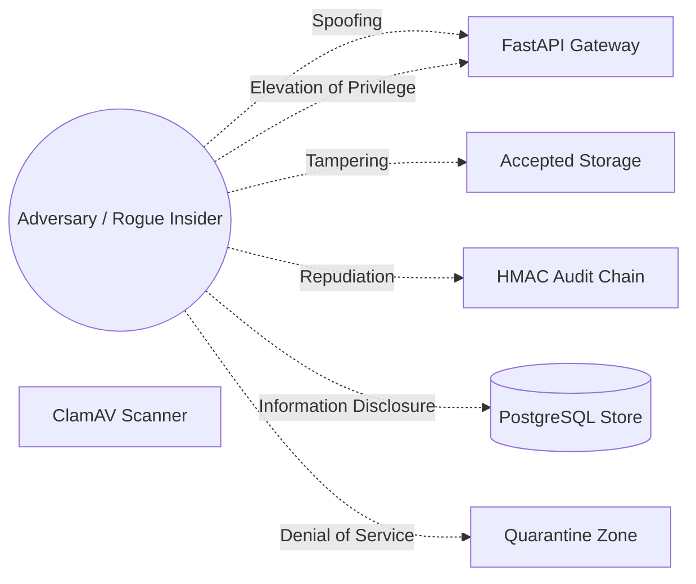

# DRISTI-NET — STRIDE Threat Model & Security Posture

## 1. System Context & Assets

DRISTI-NET manages high-value sensitive digital evidence, person-of-interest records, telephone call detail records (CDRs), banking transactions, and supervisory decision chains.

**Primary Assets**:
1. Authoritative Evidence Objects (raw files in MinIO/S3).
2. Evidentiary Claims and Provenance Locators.
3. Cryptographic Audit Chain and Signature Keys.
4. User Identity & Case Assignment Registry.
5. Entity Resolution Match Proposals and Supervisory Notes.

---

## 2. STRIDE Analysis & Security Controls

| Threat Category | Specific Threat | Impact | Technical Control & Mitigation |
|---|---|---|---|
| **Spoofing** | Attacker crafts forged JWT claiming Investigator or Admin privileges. | Unauthorized case access, data exfiltration. | HMAC-SHA256 signature verification with minimum 32-character secret key (`SECRET_KEY`), strict expiry validation, and user existence verification in DB on every request. |
| **Tampering** | Rogue actor modifies an accepted evidence file on disk to alter investigation facts. | Evidentiary corruption, contaminated investigation. | Pre-extraction SHA-256 hash validation (`storage.verify_hash`). Any byte mismatch triggers immediate `INTEGRITY_MISMATCH` status, blocks extraction, and logs high-priority audit alarm. |
| **Repudiation** | Supervisory reviewer denies approving an entity merge or unmasking a suspect. | Lack of accountability, legal challenge in court. | Every arbitration decision and unmasking event requires officer badge, IP address, mandatory justification string, and generates an HMAC-SHA256 signed audit record linked in the hash chain. |
| **Information Disclosure** | Unauthorized officer browses sensitive case data outside their jurisdiction. | Privacy violation under DPDP Act 2023, leak of sensitive intelligence. | Mandatory `authorize_case()` dependency strictly enforcing jurisdiction equality and active case assignment; default PII masking across all schemas. |
| **Denial of Service** | Adversary uploads massive compression bombs or thousands of junk files. | Node crash, disk exhaustion, service unavailability. | Max file size limit (`MAX_UPLOAD_MB=25`), page limit (`PDF_MAX_PAGES=500`), CSV row limit (`CSV_MAX_ROWS=50000`), archive decompression ratio checks, and Redis login rate-limiting. |
| **Elevation of Privilege** | Low-privilege user invokes administrative or review arbitration endpoints. | Unauthorized merge decisions, policy bypass. | Role-based access control decorators (`require_roles("REVIEWER")`, `require_roles("ADMIN")`) enforced at the FastAPI router dependency layer. |

---

## 3. Residual Risk & Review Cadence

- **Residual Risk**: A compromised host system with root access could theoretically inspect process memory or access database storage directly.
- **Countermeasure**: Host hardening, non-root application execution (`User=ubuntu`), restricted file permissions (`600` on storage), and periodic offsite audit ledger anchoring to external ledgers (Hyperledger Besu).
